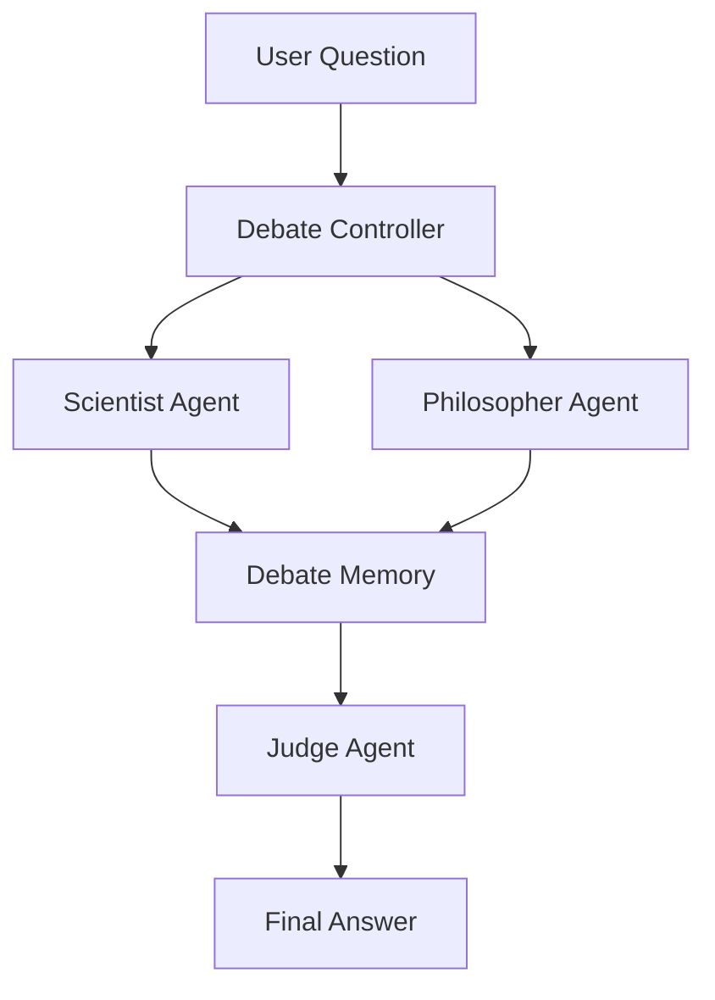

# PI Debate
***Multi-Agent Debate***

- Multiple LLM agent argue & a final agent decide the answer 



***Roadmap***
- [x] Two agents + one judge 
- [x] Run both agents in parallel using LangGraph
- [ ] Add a rebuttal round where agents read each other's responses
- [ ] Extract each agent into its own subgraph
- [ ] Introduce shared memory and conversation history
- [ ] Add tools (search, RAG) to appropriate agents
- [ ] Add a router that dynamically chooses which experts participate based on the user's question

***Upgrades***
- [ ] ***Version 1: Add more agents***
    - Scientist
    - Philosopher
    - Economist
    - Lawyer
    - Historian
    - Skeptic (whose job is to find flaws)
- [ ] ***Version 2: Introduce multiple debate rounds***
    - Initial argument
    - Rebuttal
    - Defense
    - Closing statement
- [ ] ***Version 3: Assign confidence scores***
    Each agent returns:
    ```python
        {
            "argument": "...",
            "confidence": 0.82
        }
    ```
- [ ] ***Version 4: Use tools selectively***
    - Scientist → web search, paper retrieval
    - Economist → calculator or spreadsheet
    - Lawyer → legal document retrieval
    - Philosopher → reasoning only
- [ ] ***Version 5: Add long-term memory***
    Store previous debates in a vector database so agents can reference earlier discussions or avoid repeating weak arguments
- [ ] ***Version 6: Support human intervention***
    Pause after the first debate round, allow a human to ask follow-up questions or challenge an argument, then resume the graph with the updated context