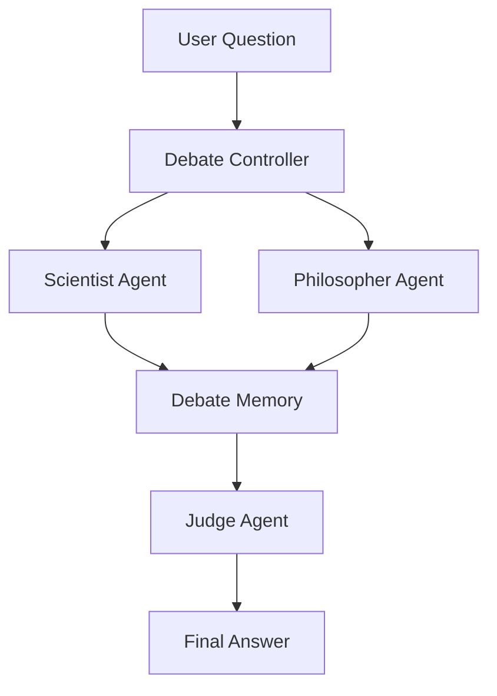

# PI Debate
***Multi-Agent Debate***

- Multiple LLM agent argue & a final agent decide the answer 



***Roadmap***
- [x] Two agents + one judge 
- [x] Run both agents in parallel using LangGraph
- [ ] Add a rebuttal round where agents read each other's responses
- [ ] Extract each agent into its own subgraph
- [ ] Introduce shared memory and conversation history
- [ ] Add tools (search, RAG) to appropriate agents
- [ ] Add a router that dynamically chooses which experts participate based on the user's question

***Upgrades***
- [ ] ***Version 1: Add more agents***
    - Scientist
    - Philosopher
    - Economist
    - Lawyer
    - Historian
    - Skeptic (whose job is to find flaws)
- [ ] ***Version 2: Introduce multiple debate rounds***
    - Initial argument
    - Rebuttal
    - Defense
    - Closing statement
- [ ] ***Version 3: Assign confidence scores***
    Each agent returns:
    ```python
        {
            "argument": "...",
            "confidence": 0.82
        }
    ```
- [ ] ***Version 4: Use tools selectively***
    - Scientist → web search, paper retrieval
    - Economist → calculator or spreadsheet
    - Lawyer → legal document retrieval
    - Philosopher → reasoning only
- [ ] ***Version 5: Add long-term memory***
    Store previous debates in a vector database so agents can reference earlier discussions or avoid repeating weak arguments
- [ ] ***Version 6: Support human intervention***
    Pause after the first debate round, allow a human to ask follow-up questions or challenge an argument, then resume the graph with the updated context


PI Debate is a multi-agent AI debate system where different AI agents discuss a question from different perspectives and a judge agent produces the final response.

## Project Structure

```text
PI-DEBATE/
│
├── .agents/
├── Notebook/
│   └── main.ipynb
│
├── .env
├── .gitignore
├── agent.py
├── config.py
├── main.py
├── prompt.py
├── README.md
└── requirements.txt
```

## Run Locally

### 1. Clone the repository

```bash
git clone <your-repository-url>
cd PI-DEBATE
```

### 2. Create a virtual environment

Windows:

```bash
python -m venv .venv
.venv\Scripts\activate
```

Linux / macOS:

```bash
python3 -m venv .venv
source .venv/bin/activate
```

### 3. Install dependencies

```bash
pip install -r requirements.txt
```

### 4. Set up environment variables

Create a `.env` file in the root directory:

```text
PI-DEBATE/
├── .env
├── agent.py
├── config.py
├── main.py
└── ...
```

Add the API keys required by the project.

For example:

```env
OPENROUTER_API_KEY=your_api_key_here
```

> Do not commit your `.env` file to GitHub.

Make sure `.env` is included in `.gitignore`:

```gitignore
.env
.venv/
__pycache__/
```

### 5. Run the application

```bash
python main.py
```

If your system uses `python3`:

```bash
python3 main.py
```

## Development

After making changes, you can run the project again with:

```bash
python main.py
```

To deactivate the virtual environment:

```bash
deactivate
```